<a href="https://saikat.com.bd" target="_blank">
  <picture>
    <source media="(prefers-color-scheme: light)" srcset="./profile/banner-light.svg?v=2" />
    
  </picture>
</a>

 

  
  
  
  

 

## 🧑‍💻 About Me

- 🔭 Currently working on multiple projects and maintaining my open-source npm packages and CLI tools
- 👨‍💻 All of my projects are showcased at **[saikat.com.bd](https://saikat.com.bd/)**
- 📦 I publish and maintain developer tools on **[npm](https://saikat.com.bd/npm)** — see below
- 📝 I write about web development at **[saikat.com.bd/blog](https://saikat.com.bd/blog)**
- 💬 Ask me about **Next.js, NestJS, TypeScript, Prisma, PostgreSQL, .NET, multi-tenant SaaS APIs, or supply-chain security for JS projects**
- 🎓 B.Sc. in Computer Science & Engineering, American International University-Bangladesh (AIUB)
- ⚡ Fun fact: I think I am funny

 

## 🛠️ Tech Stack

> Derived from 100+ public repos and active work across Next.js / NestJS apps, Laravel, .NET APIs, Flutter / React Native apps, and CLI tools in TypeScript, Go, and Rust.

**Languages & runtimes**

**Frontend**

**Mobile**

**Backend & APIs**

**Data & infra**

**Payment gateways** I've integrated before

  
  
  
  
  
  
  
  
  
  
  

 

## 📦 Featured npm Packages

| Package | Description |
|:---|:---|
| [**git-ai-pilot**](https://www.npmjs.com/package/git-ai-pilot) | Automated Git workflow with AI-generated commit messages and a built-in secret scanner |
| [**scribex-editor**](https://www.npmjs.com/package/scribex-editor) | A modern, feature-rich WYSIWYG editor for React built on TipTap and shadcn/ui |
| [**nestjs-api-forge**](https://www.npmjs.com/package/nestjs-api-forge) | Standardized API response formatting, error handling, and exception filters for NestJS |
| [**social-auth-unifier**](https://www.npmjs.com/package/social-auth-unifier) | Unified social auth (Google, Twitter, Facebook, LinkedIn, GitHub) for NestJS |
| [**nestjs-google-oauth**](https://www.npmjs.com/package/nestjs-google-oauth) | Google OAuth2 authentication strategy for NestJS |
| [**nestjs-twitter-oauth**](https://www.npmjs.com/package/nestjs-twitter-oauth) | Twitter/X OAuth2 authentication strategy for NestJS |
| [**@mirzasaikatahmmed/token-monitor**](https://www.npmjs.com/package/@mirzasaikatahmmed/token-monitor) | Global CLI that collects AI coding tool usage (Claude Code, Cursor, Codex, Copilot, and more) and ships it to a dashboard |

📊 Live download stats & full list: **[saikat.com.bd/npm](https://saikat.com.bd/npm)**

 

## 🚀 Open Source & Side Projects

| Project | What it is |
|:---|:---|
| [**gitshield**](https://github.com/mirzasaikatahmmed/gitshield) | Go pre-clone/pull scanner for obfuscated malware hidden in Node config files (`eslint`, `next`, `vite`, `tailwind` configs) and `.vscode/tasks.json` |
| [**ds-cli**](https://github.com/mirzasaikatahmmed/ds-cli) | Fast, cross-platform Rust CLI to check domain name availability across many TLDs in parallel |
| [**nestjs-backend-template**](https://github.com/mirzasaikatahmmed/nestjs-backend-template) | NestJS + Prisma backend starter, malware-hardened, usable as a GitHub template |
| [**nextjs-frontend-template**](https://github.com/mirzasaikatahmmed/nextjs-frontend-template) | Next.js App Router frontend starter, malware-hardened, usable as a GitHub template |
| [**SaaS-based-School-Management-System-API**](https://github.com/mirzasaikatahmmed/SaaS-based-School-Management-System-API) | Multi-tenant .NET API for admissions, students, parents, and auth |
| [**FieldOps-API**](https://github.com/mirzasaikatahmmed/FieldOps-API) | Multi-tenant field service and inspection API (.NET 8): jobs, checklists, photos |
| [**uptimeMonitor**](https://github.com/mirzasaikatahmmed/uptimeMonitor) | Public status page for my sites, powered by Upptime |

🏢 I also build client work in the **[Visual-Studio-NYC](https://github.com/Visual-Studio-NYC)** and **[EnterkeyBD](https://github.com/EnterkeyBD)** organizations.

 

## 📊 GitHub Stats

 

## 🌐 Connect with me

